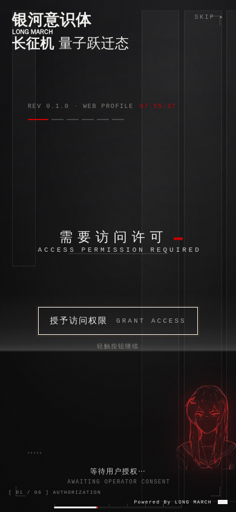
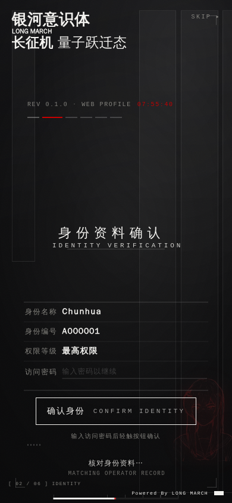
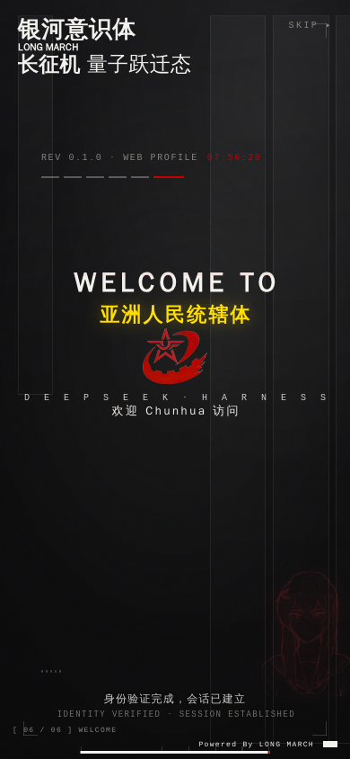

# DSH 启动动画 · 手机版

给 **DSHA（Android）/ DSH Web** 用的启动动画插件：黑幕徽章 → 过曝洗白 → 暗色技术档案 → 五步访问授权 → 色散揭幕。中文主字 + 英文等宽副标题，带真声台词、界面音效和赛博电子风立绘。

这个仓库是 [原项目](https://github.com/huzhengcai471-crypto/dsh-startup-secret) 的**手机适配版**：动画内容不变，重排了竖屏 / 横屏 / 软键盘下的排版与触控文案，专为“只有手机、没有电脑”的使用者准备。

<p align="center">
  
  
  
</p>

## 一分钟装好（不需要电脑）

1. **下载安装包**：打开 [Releases](https://github.com/nmc114/dsh-startup-secret-mobile/releases)，点最新版本里的 `dsh-startup-secret-x.y.z.tgz`。手机浏览器直接下载，**不用解压**。
2. **导入 DSHA**：DSHA → 设置 → 插件管理 → 导入插件包 → 选刚下载的 `.tgz`。
3. **重启 Web**：确认安装后按提示重启（或把 DSHA 从后台划掉再打开）。
4. **看动画**：重新打开 DSH，第一屏就是启动动画。点「授予访问权限」→「确认身份」，后面自动播完。

> 需要 Android 版 **DSHA**（App 内带插件导入）。桌面端 DSH 也兼容，安装方式见 [INSTALL.md](INSTALL.md)。

## 手机上适配了什么

| 场景 | 处理 |
|---|---|
| 竖屏 360–430px | 英文副标题收字号字距、不再被裁；开场长英文换行居中 |
| 输入访问密码 | 软键盘顶起时自动切紧凑版式，收起页脚 / 计数 / 进度条 / 立绘，身份卡和按钮不被挡 |
| 横屏 844×390 | 状态行与身份卡上移收字号，按钮不出屏 |
| 第二步身份卡 | 立绘自动压暗让位，资料卡优先 |
| 底部信息 | 页脚 / 阶段计数 / 进度条收进安全区，隐藏重复的 ID 行 |
| 触屏文案 | 「轻触按钮继续」「轻触任意处进入」，不出现 Enter / Space |
| 刘海屏 / 手势条 | 全面接入 `env(safe-area-inset-*)` |
| 输入框 | 16px，避免聚焦时页面自动放大 |
| 按钮 | 触控高度 ≥ 46px，点击后不出现 WebKit 黑框 |
| 设置页 | 窄屏两列改单列，下拉框占满一行 |

细节和测试矩阵见 [docs/MOBILE.md](docs/MOBILE.md)。

## 播放与操作

| # | 中文主字 | 需要操作 |
|---|---|---|
| 1 | 需要访问许可 | 点「授予访问权限」 |
| 2 | 身份资料确认 | 点「确认身份」（设了访问密码则先输入） |
| 3 | 接收访问需求 | 自动 |
| 4 | 开始读取权限 | 自动 |
| 5 | 读取完毕 · 核验通过 | 自动 |
| 6 | 欢迎「身份名称」访问 | 自动 |

- 右上角 **SKIP** 可随时跳过；桌面端还能按 `Esc`。
- 默认**每次会话播放一次**；设置里可改成「每天一次」。
- 首次安装后的第一次播放结束，会弹一次「降世」事件窗口，轻触进入（20 秒也会自动放行）。
- 想再看一遍：**设置 → 启动动画 → 立即预览**，或新开一个对话页。

## 设置

**DSH 设置 → 启动动画**：

- **播放**：启用、显示模式（每次打开 / 每天一次）、主题、速度、自动播放（完全自动 / 点一次 / 不自动）、允许跳过。
- **身份资料**：身份名称、身份编号、权限等级、访问密码（留空则不校验）。
- **语音**：真声素材 / 系统 TTS、7 种音色、音量、播报前提示音、语速。
- **界面音效**：开关、音量、内置素材 / 现场合成。
- **视觉**：强调色、故障色、5 款立绘（含「空」）、图案（徽章 / 东亚防御倡议）、降世事件窗口。
- **文案**：品牌三行、黑幕三行、终幕方框、页脚。

完整说明见 [docs/SETTINGS.md](docs/SETTINGS.md)。

## 常见问题

**重启后没看到动画？**
检查「设置 → 启动动画 → 启用」是否打开；同一个浏览器会话只播一次，新开页面或重开 App 会再播。

**导入插件时报错？**
确认下载的是 `.tgz` 且没有解压；确认 DSHA 版本支持插件导入。可先删除旧版本再导入。

**输入密码时页面被键盘遮住？**
本版已按 `visualViewport` 自动切紧凑版式；如果仍异常，请附上机型和系统版本提 Issue。

**会联网 / 要权限吗？**
不会。插件无任何网络请求、不申请系统权限，配置只存在本机 `~/.dsh/dsh-startup.json`，音频素材随包内联。

**怎么卸载？**
DSHA 插件管理里删除 `dsh-startup-secret`，重启 Web 即可；桌面端可用 `dsh plugin --profile web remove dsh-startup-secret`。

## 兼容性

| 项 | 说明 |
|---|---|
| DSH | `0.2.1-rc.2` 实测通过（原插件声明适配 `0.2.1-rc.3`） |
| 设备 | Android 手机，DSHA；竖屏 360×800 / 390×844 / 430×932、横屏 844×390 实机 + WebKit 渲染验证 |
| Node | ≥ 20（仅打包/测试需要，手机用户不用） |

## 从源码构建

```bash
npm pack          # 生成 dsh-startup-secret-x.y.z.tgz
npm test          # 265 项断言
```

发布流程（`npm pack` + 上传 Release 附件）和可选的 GitHub Actions 配置见 [docs/DEV.md](docs/DEV.md)。

## 声明

本作品为**二次创作**，仅用于个人学习与交流，没有任何商业用途。视觉风格、图形素材（徽章、人物立绘）与音频素材的相关权利均归原权利人所有，本仓库不对上述内容主张任何权利，亦未获得任何形式的授权或背书。

本仓库相对原项目只修改了前端样式与少量交互逻辑（`lib/splash.css`、`lib/splash.js`、`lib/client.js`），没有新增第三方素材。任何人基于本作品进行的再修改、再分发等行为，产生的侵权、纠纷或任何法律责任，均由该行为人自行承担。

**本作品未授权任何商业用途。如有侵权，请联系移除。**

- 原项目：<https://github.com/huzhengcai471-crypto/dsh-startup-secret>
- 许可：[MIT](LICENSE)，素材权利声明见 [NOTICE.md](NOTICE.md)
